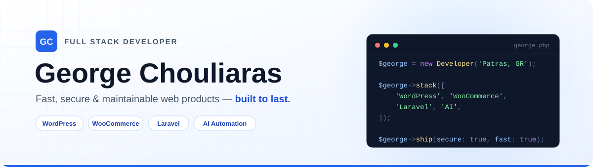
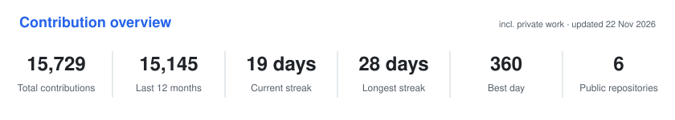

<picture>
  <source media="(prefers-color-scheme: dark)" srcset="./profile/header-dark.svg" />
  
</picture>

  
  
  
  

## About

I'm a full stack developer based in **Patras, Greece**, building fast, secure and maintainable web products for clients across the EU and remotely worldwide. My focus is the **WordPress, WooCommerce and Laravel** ecosystem — and more and more of my work brings **AI into real products** through automations, agents and custom workflows.

I care about clean architecture, security and code that is still easy to work with six months later, and I'm comfortable owning a project end to end: architecture, build, deployment and long-term maintenance.

> **Timezone** EET (UTC+2 / UTC+3 in summer) &nbsp;·&nbsp; **Languages** Greek, English &nbsp;·&nbsp; **Availability** freelance projects & long-term collaborations

## What I Do

<table>
  <tr>
    <td width="50%" valign="top">
      <h3>WooCommerce Development</h3>
      High-performance online stores, B2B and wholesale platforms, custom checkout, pricing and shipping logic, and tailored extensions.
    </td>
    <td width="50%" valign="top">
      <h3>WordPress Plugins &amp; Themes</h3>
      Bespoke plugins and themes built for speed, security and long-term maintainability.
    </td>
  </tr>
  <tr>
    <td width="50%" valign="top">
      <h3>Laravel &amp; SaaS</h3>
      Custom web applications and multi-tenant SaaS products, including licensing, admin dashboards and billing-ready architecture.
    </td>
    <td width="50%" valign="top">
      <h3>AI Integration &amp; Automation</h3>
      LLM-powered features, agents and workflow automations (OpenAI, Claude, Gemini, Perplexity, Qwen, n8n) wired into real business processes.
    </td>
  </tr>
  <tr>
    <td width="50%" valign="top">
      <h3>Performance &amp; Security</h3>
      Audits, caching strategy, query optimisation and hardening for sites that must stay fast and reliable under load.
    </td>
    <td width="50%" valign="top">
      <h3>Release Management &amp; Support</h3>
      Versioned releases, changelogs and staged rollouts from Git to production — plus updates, monitoring and backups long after launch.
    </td>
  </tr>
</table>

## Selected Work

Most of my client work lives in private repositories — **happy to share details and walkthroughs on request.**

<table>
  <tr>
    <td width="50%" valign="top">
      <h3>Systems I've shipped</h3>
      <ul>
        <li><b>Licensing &amp; activation servers</b> for commercial software</li>
        <li><b>B2B commerce platforms</b> with customer-specific pricing</li>
        <li><b>Multi-tenant SaaS</b> on Laravel</li>
        <li><b>Uptime &amp; monitoring</b> for production sites</li>
        <li><b>Public-data search</b> over large datasets</li>
        <li><b>Self-hosted video</b> delivery &amp; management</li>
        <li><b>Network &amp; router automation</b></li>
      </ul>
    </td>
    <td width="50%" valign="top">
      <h3>Currently building</h3>
      <ul>
        <li>A <b>multi-tenant Laravel SaaS</b> with its own licensing and activation layer</li>
        <li><b>Deployment tooling</b> that ships WordPress &amp; Laravel apps from Git to production</li>
        <li><b>Data pipelines &amp; scrapers</b> for large public datasets</li>
        <li><b>AI agents</b> that automate real business tasks</li>
      </ul>
    </td>
  </tr>
</table>

### Open-source WordPress plugins

<table>
  <tr>
    <td width="50%" valign="top">
      <a href="https://github.com/ghouliaras/wp-cache-inspector"><b>wp-cache-inspector</b></a> 
      Diagnose server, page, object and browser caching — HIT/MISS tests, response headers, a dev no-cache mode and one-click purging.
    </td>
    <td width="50%" valign="top">
      <a href="https://github.com/ghouliaras/admin-quick-search"><b>admin-quick-search</b></a> 
      A universal quick search for the WordPress admin to jump straight to posts, pages, users and more.
    </td>
  </tr>
  <tr>
    <td width="50%" valign="top">
      <a href="https://github.com/ghouliaras/broken-image-replacer"><b>broken-image-replacer</b></a> 
      Detects broken images and replaces them with a customisable placeholder.
    </td>
    <td width="50%" valign="top">
      <a href="https://github.com/ghouliaras/classic-editor-widgets"><b>classic-editor-widgets</b></a> 
      Restores the classic TinyMCE editor and the classic widget screens.
    </td>
  </tr>
</table>

## Tech Stack

**Languages** 

**Frameworks, CMS &amp; Frontend** 

**Databases &amp; DevOps** 

**Hosting &amp; CDN** 

**AI &amp; Automation** 

**Project &amp; Release Management** 

## How I Work

<table>
  <tr>
    <td width="50%" valign="top">
      <b>Clean, maintainable code</b> 
      Readable structure, sensible conventions and documentation the next developer can build on.
    </td>
    <td width="50%" valign="top">
      <b>Security first</b> 
      Safe defaults, careful handling of data and hardening where it matters.
    </td>
  </tr>
  <tr>
    <td width="50%" valign="top">
      <b>Performance minded</b> 
      Fast load times, lean queries and caching that scales with real traffic.
    </td>
    <td width="50%" valign="top">
      <b>Clear communication</b> 
      Straightforward updates, honest timelines and no jargon for its own sake.
    </td>
  </tr>
</table>

**A typical engagement:** discovery call → scoped proposal &amp; estimate → iterative build with regular demos → launch → ongoing support.

## GitHub Activity

<!-- Cards are generated daily by .github/workflows/readme-cards.yml and stored in /profile.
     The overview includes private client work from the contribution calendar. -->
<picture>
  <source media="(prefers-color-scheme: dark)" srcset="./profile/overview-dark.svg" />
  
</picture>

## Let's Work Together

Have a project in mind, need a WooCommerce store that actually performs, or want to add AI to your product? I'd be glad to hear from you.

  
  

