<!-- ================= HEADER ================= -->

  
  
  
  

  <b>I build fast, secure and maintainable web products — from high-traffic WooCommerce stores to multi-tenant Laravel SaaS and AI-powered automations.</b>

---

## 👋 About Me

I'm a full stack developer based in **Patras, Greece**, working with clients across the EU and remotely worldwide.
My focus is the **WordPress, WooCommerce and Laravel** ecosystem, and more and more of my work brings **AI into real products** through automations, agents and custom workflows.

I care about clean architecture, security and code that is still easy to work with six months later — and I'm comfortable owning a project end to end, from architecture and build to deployment and long-term maintenance.

| | |
| --- | --- |
| 📍 **Location** | Patras, Greece · EET (UTC+2 / UTC+3 in summer) |
| 💼 **Availability** | Open to freelance projects and long-term collaborations |
| 🗣️ **Languages** | Greek (native) · English |
| 🧩 **Specialities** | WooCommerce · WordPress plugins · Laravel SaaS · AI automation · Performance & security |

---

## 🛠️ What I Do

| Service | What you get |
| --- | --- |
| **WooCommerce Development** | High-performance online stores, B2B / wholesale platforms, custom checkout, pricing and shipping logic, tailored extensions. |
| **WordPress Plugins & Themes** | Bespoke plugins and themes built for speed, security and long-term maintainability. |
| **Laravel & SaaS** | Custom web applications and multi-tenant SaaS products, including licensing, billing-ready architecture and admin dashboards. |
| **AI Integration & Automation** | LLM-powered features, agents and workflow automations (OpenAI, Claude, n8n) wired into real business processes. |
| **Performance & Security** | Audits, caching strategy, query optimisation and hardening for sites that must stay fast and reliable under load. |
| **Maintenance & Support** | Updates, monitoring, backups and ongoing improvements after launch. |

---

## 🚀 Selected Work

Most of my client work lives in private repositories — **happy to share details and walkthroughs on request.**

**Systems I've designed and shipped**

- **Licensing & activation servers** — issuing, validating and managing licenses for commercial software.
- **B2B commerce platforms** — wholesale ordering, customer-specific pricing and tailored checkout flows.
- **Multi-tenant SaaS on Laravel** — custom dashboards, licensing and automation.
- **Uptime & monitoring systems** — keeping production sites observable and reliable.
- **Public-data search tools** — fast search and aggregation over large, regularly updated datasets.
- **Self-hosted video platform** — media delivery and management.
- **Network & router automation** — scripting and automating network infrastructure.

**Open-source WordPress plugins**

| Plugin | Description |
| --- | --- |
| [**wp-cache-inspector**](https://github.com/ghouliaras/wp-cache-inspector) | Diagnose server, page, object and browser caching — HIT/MISS tests, response headers, a dev no-cache mode and one-click purging. |
| [**admin-quick-search**](https://github.com/ghouliaras/admin-quick-search) | A universal quick search for the WordPress admin to jump straight to posts, pages, users and more. |
| [**broken-image-replacer**](https://github.com/ghouliaras/broken-image-replacer) | Detects broken images and replaces them with a customisable placeholder. |
| [**classic-editor-widgets**](https://github.com/ghouliaras/classic-editor-widgets) | Restores the classic TinyMCE editor and the classic widget screens. |

**Currently building**

- A **multi-tenant Laravel SaaS** with its own licensing and activation layer.
- **Deployment tooling** that ships WordPress and Laravel apps from Git to production reliably.
- **Data pipelines & scrapers** for collecting and searching large public datasets.
- **AI agents** that automate real business tasks.

---

## 🧰 Tech Stack

<table>
  <tr>
    <td align="right"><b>Languages</b></td>
    <td></td>
  </tr>
  <tr>
    <td align="right"><b>Frameworks &amp; CMS</b></td>
    <td>
      
      
    </td>
  </tr>
  <tr>
    <td align="right"><b>Databases &amp; DevOps</b></td>
    <td></td>
  </tr>
  <tr>
    <td align="right"><b>AI &amp; Automation</b></td>
    <td>
      
      
      
    </td>
  </tr>
</table>

---

## 🤝 How I Work

| Principle | In practice |
| --- | --- |
| **Clean, maintainable code** | Readable structure, sensible conventions and documentation the next developer (often future me) can build on. |
| **Security first** | Safe defaults, careful handling of data and hardening where it matters. |
| **Performance minded** | Fast load times, lean queries and caching that scales with real traffic. |
| **Clear communication** | Straightforward updates, honest timelines and no jargon for its own sake. |

**A typical engagement:** discovery call → scoped proposal & estimate → iterative build with regular demos → launch → ongoing support.

---

## 📊 GitHub Activity

<!-- Cards are generated daily by .github/workflows/readme-cards.yml and stored in /profile.
     The overview includes private client work from the contribution calendar. -->

  <picture>
    <source media="(prefers-color-scheme: dark)" srcset="./profile/overview-dark.svg" />
    
  </picture>

  <picture>
    <source media="(prefers-color-scheme: dark)" srcset="./profile/top-langs-dark.svg" />
    
  </picture>

---

## 📬 Let's Work Together

Have a project in mind, need a WooCommerce store that actually performs, or want to add AI to your product?
**Get in touch — I'd be glad to hear from you.**

  
  

